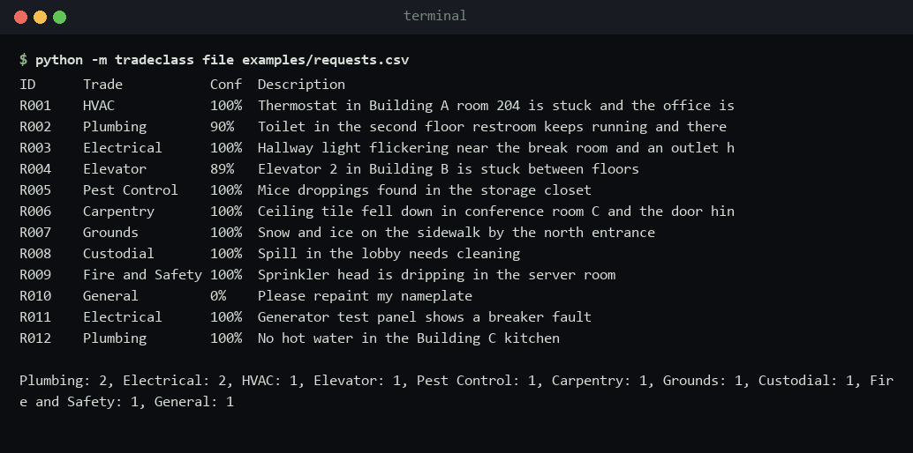

# trade-keyword-classifier

Maps a free text maintenance description such as "toilet leak under the sink" to a trade (HVAC, Plumbing, Electrical and so on) using weighted keywords. It is a transparent rule scorer: you can see which words matched and change the word list.



## What it is for

Requests arrive as plain sentences, and someone must route each one to the right shop. This tool does a first pass: it scores every trade by the keywords found, picks the highest, shows a confidence figure and lists the runners up. Dispatchers can use it to pre-sort a batch of requests, and teams with their own trades (for example Network or Security) can supply their own rules file.

## Install

```
git clone https://github.com/yassine2med/trade-keyword-classifier
cd trade-keyword-classifier && pip install -r requirements.txt
```

## How to use

| I want to | Command |
|---|---|
| Classify one description | `PYTHONPATH=src python -m tradeclass text "Toilet leak and the light is flickering"` |
| Classify the description column of a CSV | `PYTHONPATH=src python -m tradeclass file examples/requests.csv` |
| Get JSON instead of a table | add `--json` to `file` |
| Use a column with another name | add `--column NAME` to `file` |
| Use my own trades and keywords | `PYTHONPATH=src python -m tradeclass --rules examples/rules.json text "wifi router down"` |
| List trades and keyword counts | `PYTHONPATH=src python -m tradeclass trades` |
| Show help | `PYTHONPATH=src python -m tradeclass --help` |

A rules file is JSON shaped like `{"Trade": {"keyword": weight}}` and replaces the defaults (see `examples/rules.json`). Exit codes: 0 on success, 1 for a missing file, bad rules file or missing column, 2 for bad arguments.

Example:

```
PYTHONPATH=src python -m tradeclass file examples/requests.csv
```

Output:

```
ID      Trade           Conf  Description
R001    HVAC            100%  Thermostat in Building A room 204 is stuck and the office is
R002    Plumbing        90%   Toilet in the second floor restroom keeps running and there 
R003    Electrical      100%  Hallway light flickering near the break room and an outlet h
R004    Elevator        89%   Elevator 2 in Building B is stuck between floors
R005    Pest Control    100%  Mice droppings found in the storage closet
R006    Carpentry       100%  Ceiling tile fell down in conference room C and the door hin
R007    Grounds         100%  Snow and ice on the sidewalk by the north entrance
R008    Custodial       100%  Spill in the lobby needs cleaning
R009    Fire and Safety 100%  Sprinkler head is dripping in the server room
R010    General         0%    Please repaint my nameplate
R011    Electrical      100%  Generator test panel shows a breaker fault
R012    Plumbing        100%  No hot water in the Building C kitchen

Plumbing: 2, Electrical: 2, HVAC: 1, Elevator: 1, Pest Control: 1, Carpentry: 1, Grounds: 1, Custodial: 1, Fire and Safety: 1, General: 1
```

A mixed request shows the runner up:

```
Trade: Plumbing (score 6, confidence 55%)
Matched: leak, toilet
  Plumbing        6
  Electrical      5
```

Run the tests with `python -m pytest -q`.

## How it works

1. The text is lower cased. Each keyword counts only as a whole word (a plural "s" is allowed), so "ice" does not fire inside "office".
2. Every matched keyword adds its weight to its trade. Specific words weigh 3 or 4, vague words such as "water" or "wall" weigh 1.
3. The trade with the highest score wins. Ties go to the trade name that sorts first.
4. Confidence is the winner's share of all points scored. It is not a probability.
5. With no match the result is General with score 0.

## Limits

- Keyword matching only. It does not understand negation, context or other languages.
- Confidence of 100 percent means only one trade matched, not that the answer is right. "Sprinkler head is dripping" scores as Fire and Safety even though a plumber may also be needed.
- Mixed requests get one trade. Read the ranking when the confidence is low.
- The default weights are a reasonable starting point, tuned by hand. Check them against your own requests.

## License

MIT. Yassine Emhamed, 2026.
